# Microwave heating: characterization and optimization

TIPE 2024/2025 (PC*), by Valentin Lachaise, candidate N°35483.

Study of how microwaves heat a material and why hot spots appear, combining modelling, simulation and experiments.

Slides, in French: [tipe-microwave-heating-slides.pdf](docs/tipe-microwave-heating-slides.pdf)

## Motivation
In Courty's well-known experiment, a potato heated in a microwave oven shows hot spots that a thermal camera reveals. The goal is to understand where they come from and how to control them.

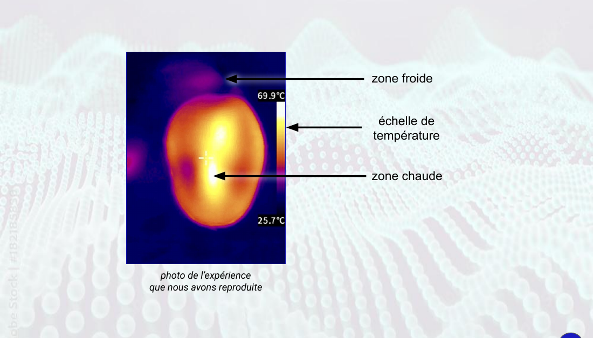

## Approach
- **Physics**: Mie resonances inside the heated object, evanescent waves, energy balance of the heating process.
- **Modelling**: Maxwell equations solved numerically in Python.
- **Experiments**: temperature mapping with a thermal camera, on agar-agar samples cast in 3D-printed waveguide moulds modelled in SolidWorks.
- **Application**: use of microwave heating for ester synthesis.

The slides are in French, so the captions of the images below are too.

## 1. Invalidating the "foci" theory
The hot spots are sometimes explained by the foci of an elliptical sample. For an ellipse, the ratio between the distance between the foci and the major axis is sqrt(1 - (b/a)²). Measured hot spot positions do not follow this prediction.

| Ellipse and its foci | Theory vs. experiment |
|---|---|
| 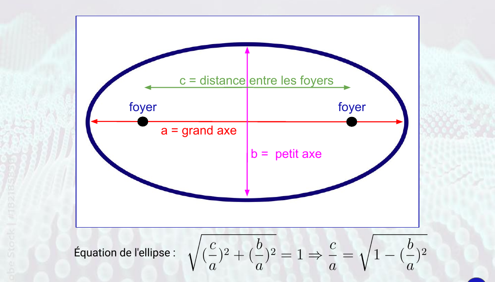 | 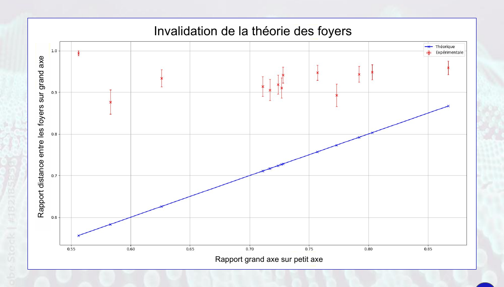 |

## 2. Reproducible waveguides
Agar-agar (20 g/L) has physical properties close to those of water. It is cast in 3D-printed shells modelled in SolidWorks, which gives reproducible samples that keep their spherical shape.

| Mould modelling | 3D printing of the shells | Agar-agar waveguide |
|---|---|---|
| 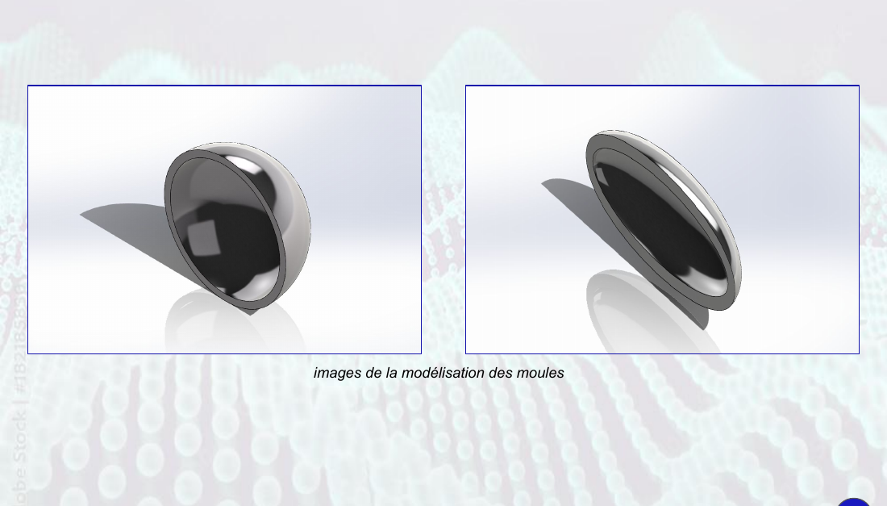 | 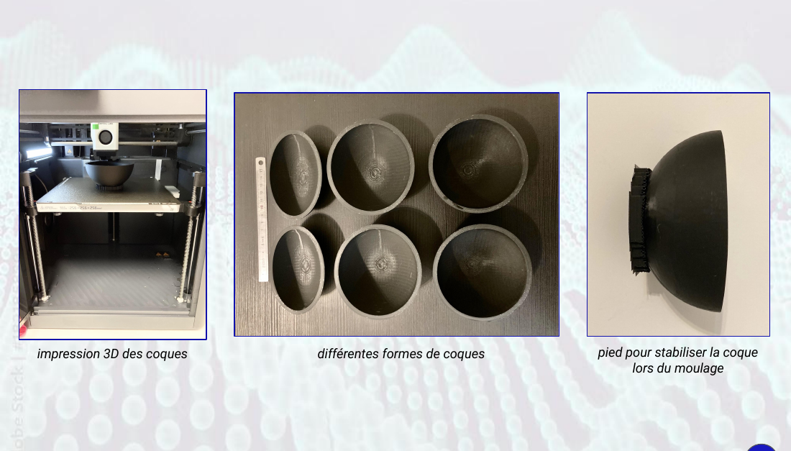 | 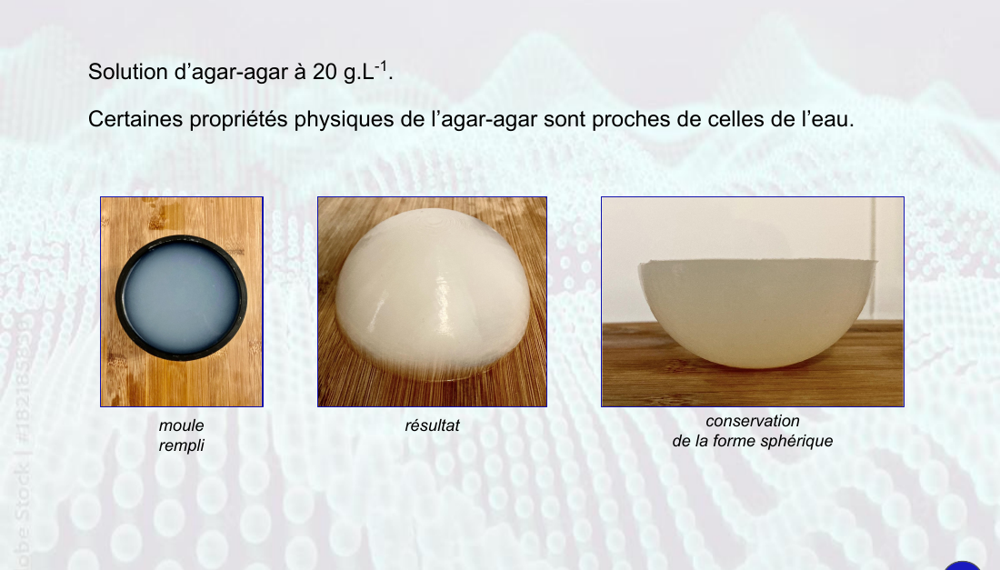 |

## 3. Analytical solutions
The wave equation in cylindrical coordinates has a solution that can be expanded as a power series (truncated at order 10) satisfying the boundary condition. The matrix equation is solved in Python. The computed electric field (left) is compared with the temperature profile measured in our experiment.

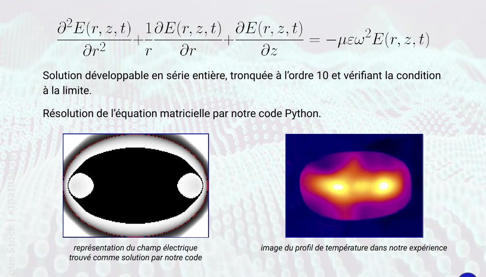

## 4. Experimental validation of the analytical models
The temperature profile along a section of the sample is compared with the square of Bessel functions (see [`src/bessel_squared.py`](src/bessel_squared.py) and [`src/temperature_profile.py`](src/temperature_profile.py)).

| Spheres | Thick cylinder | Thin cylinder |
|---|---|---|
| 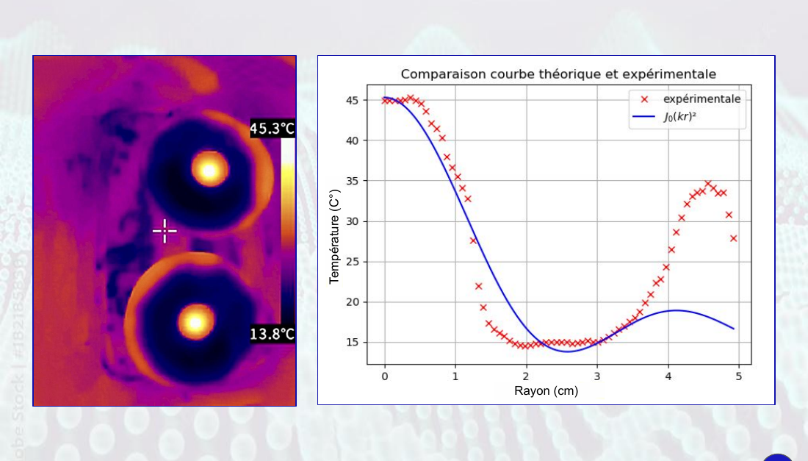 | 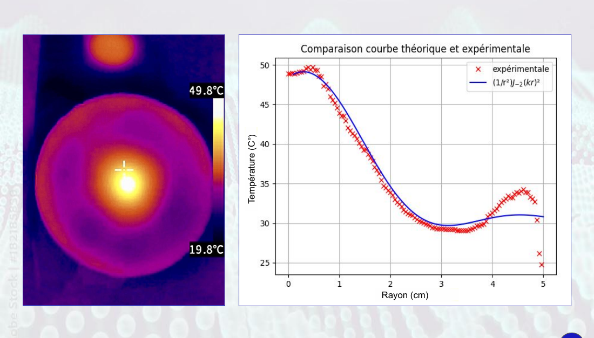 | 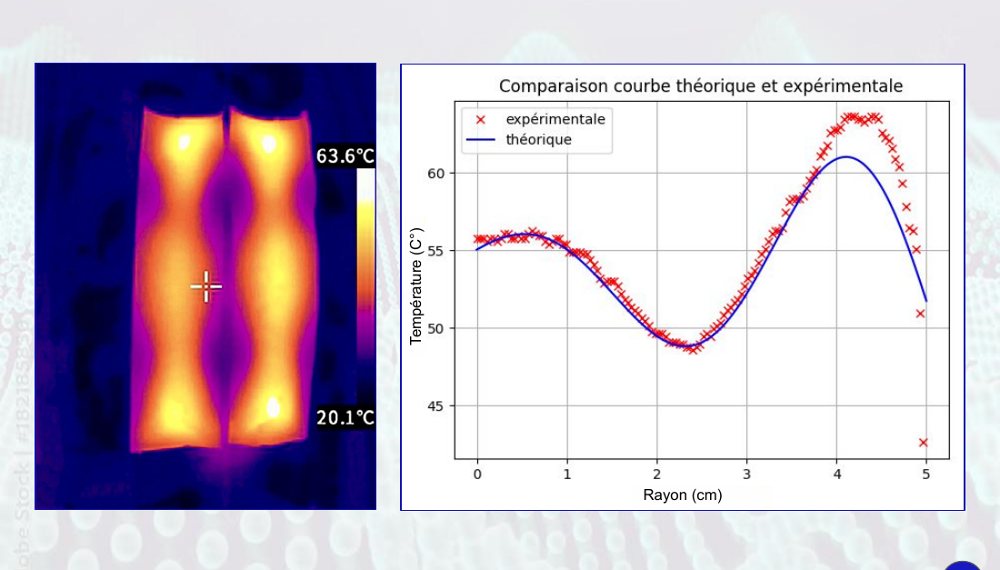 |

## 5. Energy study
The internal energy variation of the sample is computed from the thermal image ([`src/internal_energy.py`](src/internal_energy.py)). There is a shape that gives an optimal heating for a given volume.

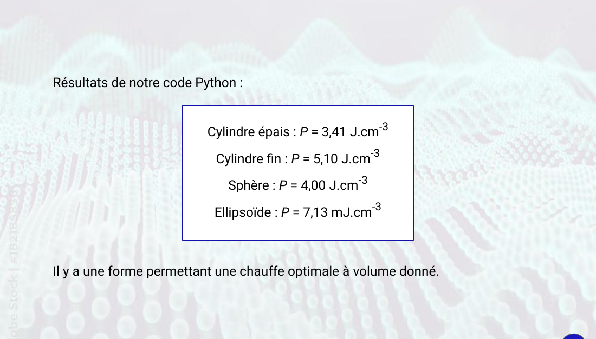

## 6. Application to a microwave chemical synthesis
Fischer esterification of ethanoic acid with 3-methylbutan-1-ol, heated for 1 minute at 570 W in the microwave oven. The remaining acid is titrated with sodium hydroxide.

| Protocol | Setup | Results |
|---|---|---|
| 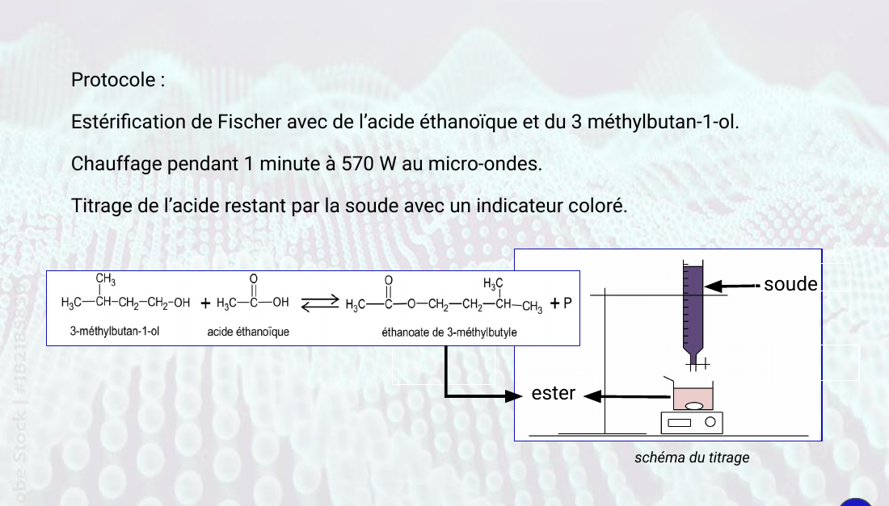 | 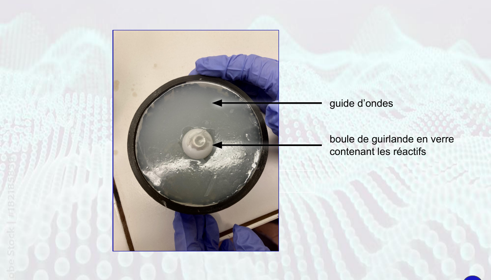 | 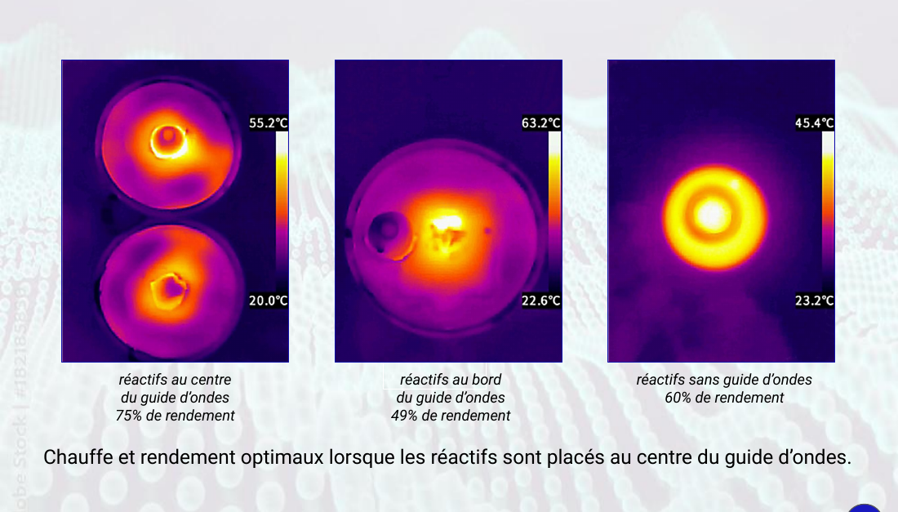 |

Heating and yield are optimal when the reagents are placed at the centre of the waveguide (75 % yield, against 49 % at the edge and 60 % without waveguide).

## What's in this repo

The analysis scripts of the study, written in Python (numpy, matplotlib, scipy, Pillow), and the slides:

| File | What it is |
|---|---|
| [`src/bessel_squared.py`](src/bessel_squared.py) | Plots the squared Bessel functions J_n(kr)², to which the measured heating profiles are compared (sphere and thick cylinder, slides 14 and 15). |
| [`src/temperature_profile.py`](src/temperature_profile.py) | Turns a thermal camera image into grey levels, then into temperatures, and plots the temperature against the radius along the central column of the image. |
| [`src/internal_energy.py`](src/internal_energy.py) | Computes the internal energy variation of a sample from a thermal image, by summing the energy stored in each pixel seen as a ring of water. |
| [`waveguide_cutoff.py`](waveguide_cutoff.py) | Cutoff frequencies of a rectangular waveguide: a mode only propagates above its cutoff frequency (illustrative helper). |
| [`docs/tipe-microwave-heating-slides.pdf`](docs/tipe-microwave-heating-slides.pdf) | The TIPE presentation slides, in French. |
| [`docs/images/`](docs/images) | The key slides as images, used in this README. |
| [`requirements.txt`](requirements.txt) | Python dependencies. |

Not in this repo: the code that solves the power-series model of the electric field (section 3), the code behind the comparison with the foci theory (section 1), and the raw thermal images.

Plot titles and labels are in French (the slides are in French too).

## Running the scripts

With Python 3 installed:

```bash
pip install -r requirements.txt
python src/bessel_squared.py
```

This plots J_0(kr)² for kr up to 15. To plot another order or range, call `trace_Bessel_carre(n, xmax)` from Python.

The two other scripts take a thermal camera image (jpg or png). Give the temperatures at the bottom and top of its colour scale (`--tmin`, `--tmax`) and the real size of the photo (`--width`, `--height`, in cm for `temperature_profile.py` and in m for `internal_energy.py`):

```bash
python src/temperature_profile.py image.jpg --tmin 19.8 --tmax 49.8 --width 10 --height 5 --title "section cylindre"
python src/internal_energy.py image.jpg --tmin 20 --tmax 60 --width 0.03 --height 0.1
```

The temperature profile is read along the central column of the image, from the bottom upwards.

## Author
Valentin Lachaise, engineering student at IMT Atlantique.
Personal website: https://vlachaise.pages.dev
